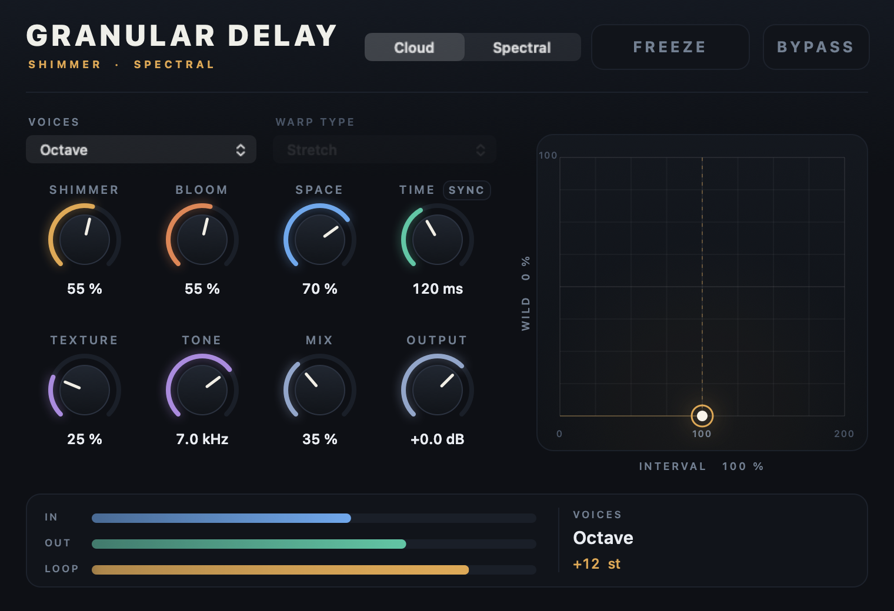

# Granular Delay

A stereo CLAP shimmer delay with a wild side. Dial in a Valhalla-style shimmer in a few seconds, or push the same handful of knobs into pitched spectral territory.



Version 1.0 is a reimagining of the earlier four-line granular delay (a full copy is at `../granular-delay-v0.4-backup`). The four lines, per-line Freeze/Memory/Scan/Morph/Drift controls, and 95 parameters are gone. In their place: one signal loop, an interval stack the plugin builds for you, and eight knobs.

## The idea

```
input ─► delay ─► voice stack ─► reverb ─► tone ─┬─► wet ─► mix ─► output
            ▲      (pitch shift)                  │
            └────────── feedback (Bloom) ─────────┘
```

The pitch shifter sits **inside** the reverb loop. Every pass through the loop climbs another interval and gets diffused; that recirculation is a shimmer. Freeze mutes the input and holds the loop at the level it had when frozen.

Two characters share the same controls:

- **Cloud**: a granular pitch shifter. **Texture** runs from a smooth, clean shimmer (two crossfaded heads) to scattered, dense grains with spray and stereo scatter. **Warp** adds per-grain pitch scatter, octave jumps, bends, and reversal.
- **Spectral**: an STFT engine. All voices are shifted in the frequency domain and every spectral peak moves with its neighbouring bins, so chords keep their shape. **Warp** bends the spectrum in one of five ways, and **Texture** smears it in time.

See [docs/controls.md](docs/controls.md) for every control and a few starting points, and [docs/design.md](docs/design.md) for how it works and where its limits are.

## Build and install on macOS

Requires CMake 3.22+ and an Xcode command-line C++17 compiler. CLAP headers are included; builds do not download dependencies.

```sh
cmake -S . -B build -DCMAKE_BUILD_TYPE=Release
cmake --build build --parallel && ctest --test-dir build --output-on-failure
python3 tools/install_macos.py
```

Search **Granular Delay** in Bitwig's browser. The installer stages the signed bundle and renames it into place, preserving the previous bundle. Reload the plugin (or restart Bitwig) after installing.

Sessions saved by 0.x are not compatible and load with the new defaults.

Other targets: `build/render_demo artifacts/demos` renders nine example WAVs, `build/editor_snapshot out.png [param=value ...]` renders the editor to a PNG, and `EditorPreview.app` hosts the CLAP GUI in a window.

## Source

- `src/Processor.*`: the loop, voice stack, freeze, safety, and output stage.
- `src/CloudEngine.*`, `src/SpectralEngine.*`, `src/Fft.h`: the two pitch engines.
- `src/Reverb.*`: eight-channel modulated feedback network with input diffusion.
- `src/Parameters.h`: parameter IDs, ranges, defaults, and the interval presets.
- `src/Plugin.cpp`: CLAP lifecycle, automation/modulation, tempo, remote controls, state.
- `src/Editor.mm`: native macOS editor.
- `tests/`: engine, processor, and CLAP host tests.

Stereo 32-bit audio. Settings are saved with the project. The CMake build also has Linux/Windows CLAP targets with host-provided parameter controls; those platforms have not been tested. See [third-party notices](THIRD_PARTY_NOTICES.md).
